# GlobalTrade.ai — Integration Baseline & Developer Standards

**Version:** Post T1.1–T1.7 Baseline (Verified)  
**Target:** 4-Person Parallel Development Team  
**Scope:** Architecture Standards, Shared Boundaries, API & UI Conventions, Conflict Avoidance

---

## 1. Existing Reusable Patterns (Must Follow)

### 1.1 Backend Authentication & Current User Dependency
All backend endpoints must use the canonical authentication dependencies in [`backend/app/core/auth/dependencies.py`](file:///Users/bhavikesh/Documents/Sem_5/GlobalTrade/backend/app/core/auth/dependencies.py).

```python
from fastapi import APIRouter, Depends
from sqlalchemy.orm import Session
from app.db.session import get_db
from app.models.user import User
from app.core.auth.dependencies import get_current_user

router = APIRouter(prefix="/v1/my-feature", tags=["My Feature"])

@router.get("/")
def list_items(
    db: Session = Depends(get_db),
    current_user: User = Depends(get_current_user),
):
    ...
```
* `get_current_user` extracts the JWT claims, auto-provisions or looks up the local `User` record in PostgreSQL by `auth0_user_id`, and returns the `User` ORM instance.

### 1.2 RBAC & Organization Isolation Enforcement
Multi-tenancy and permissions **must** be enforced using [`backend/app/core/auth/permissions.py`](file:///Users/bhavikesh/Documents/Sem_5/GlobalTrade/backend/app/core/auth/permissions.py). Never manually query or construct raw role checks from scratch.

* **Check membership and return membership object:**
  ```python
  from app.core.auth.permissions import get_membership_or_403

  membership = get_membership_or_403(
      db=db,
      user_id=current_user.id,
      organization_id=organization_id,
      allowed_roles=["ADMIN", "MEMBER", "EXPORTER"]  # or omit allowed_roles to allow any valid member
  )
  ```
* **Require ADMIN role strictly:**
  ```python
  from app.core.auth.permissions import require_admin

  membership = require_admin(
      db=db,
      user_id=current_user.id,
      organization_id=organization_id
  )
  ```
* **Always filter queries by `organization_id`:**
  ```python
  # Every tenant-scoped entity MUST be queried with organization_id filter
  items = db.query(MyModel).filter(
      MyModel.organization_id == organization_id,
      ...
  ).all()
  ```

### 1.3 Pydantic Schemas & Validation Pattern
Follow the exact conventions used in [`app/schemas/organization.py`](file:///Users/bhavikesh/Documents/Sem_5/GlobalTrade/backend/app/schemas/organization.py):
* `BaseModel` + `ConfigDict(from_attributes=True)` or `model_config = {"from_attributes": True}` on Read models.
* Use `@field_validator(..., mode="before")` with `@classmethod` for string stripping, normalization, and URL validation.
* For `Update` schemas, fields must default to `None`. In endpoints, use `update_data = schema.model_dump(exclude_unset=True)` before applying changes to the model.

### 1.4 Frontend BFF Proxy Pattern
The browser client **never** speaks directly to port 8000. All browser HTTP requests must flow through Next.js BFF proxy [`src/app/api/backend/[...path]/route.ts`](file:///Users/bhavikesh/Documents/Sem_5/GlobalTrade/frontend/src/app/api/backend/[...path]/route.ts) which injects the server-side Auth0 access token.

* Frontend requests **must** use `fetchWithAuth<T>()` from [`src/lib/api.ts`](file:///Users/bhavikesh/Documents/Sem_5/GlobalTrade/frontend/src/lib/api.ts):
  ```typescript
  import { fetchWithAuth } from "@/lib/api";

  const products = await fetchWithAuth<Product[]>("/v1/products?org_id=" + orgId);
  const updated = await fetchWithAuth<Product>("/v1/products/" + id, {
    method: "PATCH",
    headers: { "Content-Type": "application/json" },
    body: JSON.stringify(payload),
  });
  ```

### 1.5 Frontend Page & UI Lifecycle Pattern
Every interactive client page must follow the 4-phase pattern demonstrated in `src/app/company-profile/page.tsx` and `src/app/organizations/page.tsx`:
1. **Auth Guard:** `const { user, isLoading } = useUser();` — show loading spinner while `isLoading`, show sign-in prompt if `!user`.
2. **Organization Context:** Read active `org_id` (or prompt selection).
3. **Error & Notification Handling:** Capture API failure in component state (`err.message`) and present inline alerts.
4. **Optimistic/Controlled Forms:** Controlled inputs with field-level feedback and explicit Save buttons.

---

## 2. Shared Files & Modules (DO NOT Independently Redesign)

The following files constitute the project core. **No feature developer should modify, refactor, or replace these files without team lead alignment:**

| Shared File | Purpose / Risk |
| :--- | :--- |
| [`backend/app/core/auth/jwt.py`](file:///Users/bhavikesh/Documents/Sem_5/GlobalTrade/backend/app/core/auth/jwt.py) | JWKS fetching, caching, token verification. |
| [`backend/app/core/auth/dependencies.py`](file:///Users/bhavikesh/Documents/Sem_5/GlobalTrade/backend/app/core/auth/dependencies.py) | `get_current_user`, Auth0 upsert logic. |
| [`backend/app/core/auth/permissions.py`](file:///Users/bhavikesh/Documents/Sem_5/GlobalTrade/backend/app/core/auth/permissions.py) | Core RBAC role definitions (`ROLE_ADMIN`, `ROLE_MEMBER`, etc.) and `get_membership_or_403`. |
| [`backend/app/db/session.py`](file:///Users/bhavikesh/Documents/Sem_5/GlobalTrade/backend/app/db/session.py) | Engine, `SessionLocal`, `Base`, and `get_db`. |
| [`backend/app/models/user.py`](file:///Users/bhavikesh/Documents/Sem_5/GlobalTrade/backend/app/models/user.py) | Global user table. |
| [`backend/app/models/organization.py`](file:///Users/bhavikesh/Documents/Sem_5/GlobalTrade/backend/app/models/organization.py) | Organization & Company Profile schema. |
| [`backend/app/models/organization_membership.py`](file:///Users/bhavikesh/Documents/Sem_5/GlobalTrade/backend/app/models/organization_membership.py) | Membership junction table. |
| [`frontend/src/app/api/backend/[...path]/route.ts`](file:///Users/bhavikesh/Documents/Sem_5/GlobalTrade/frontend/src/app/api/backend/[...path]/route.ts) | Next.js server-side BFF proxy & Auth0 session token bridge. |
| [`frontend/src/lib/auth0.ts`](file:///Users/bhavikesh/Documents/Sem_5/GlobalTrade/frontend/src/lib/auth0.ts) | Auth0 client configuration. |
| [`frontend/src/components/navbar.tsx`](file:///Users/bhavikesh/Documents/Sem_5/GlobalTrade/frontend/src/components/navbar.tsx) | Global top navigation bar. |

---

## 3. Database & Migration Rules for Parallel Work

### 3.1 Migration Chain State
* Head revision is currently: **`0002_phase1_identity`** ([`backend/alembic/versions/0002_phase1_identity.py`](file:///Users/bhavikesh/Documents/Sem_5/GlobalTrade/backend/alembic/versions/0002_phase1_identity.py)).
* **CRITICAL RULE:** Do NOT create branch heads in Alembic by letting multiple devs auto-generate `down_revision = "0002_phase1_identity"` simultaneously.

### 3.2 Coordinated Migration Sequence
To prevent merge collisions in Alembic, migrations are assigned in sequence:
* **Feature 1 (Products):** Migration file `0003_products.py` (`down_revision = "0002_phase1_identity"`, `revision = "0003_products"`)
* **Feature 2 (Buyer/Supplier):** Migration file `0004_buyer_supplier.py` (`down_revision = "0003_products"`, `revision = "0004_buyer_supplier"`)
* **Feature 3 (RFQ/Quotation):** Migration file `0005_rfq_quotation.py` (`down_revision = "0004_buyer_supplier"`, `revision = "0005_rfq_quotation"`)
* **Feature 4 (Lead/Integration):** Migration file `0006_lead_integration.py` (`down_revision = "0005_rfq_quotation"`, `revision = "0006_lead_integration"`)

*If branches merge out of order, the merging developer is responsible for updating `down_revision` to the latest merged head.*

### 3.3 Model Registration
Every new SQLAlchemy model must:
1. Inherit from `Base` from `app.db.session`.
2. Explicitly define table names with `__tablename__ = "xyz"`.
3. Include foreign key constraints with `ondelete="CASCADE"` where organization-scoped.
4. Add indexing to `organization_id` on all tenant-specific tables.
5. Import the model in [`backend/app/models/__init__.py`](file:///Users/bhavikesh/Documents/Sem_5/GlobalTrade/backend/app/models/__init__.py) so Alembic detects it.

---

## 4. API Conventions for All New Modules

1. **Routing Prefix:** All routers must have `/v1/<resource>` prefix and be mounted under `/api` in [`backend/app/main.py`](file:///Users/bhavikesh/Documents/Sem_5/GlobalTrade/backend/app/main.py).
   * Example: `/api/v1/products`, `/api/v1/rfqs`, `/api/v1/suppliers`.
2. **HTTP Status Codes:**
   * `200 OK`: Standard read / update response.
   * `201 Created`: Resource created.
   * `204 No Content`: Resource deleted.
   * `400 Bad Request`: Validation failure.
   * `401 Unauthorized`: Missing or invalid JWT.
   * `403 Forbidden`: User not in organization or lacking role.
   * `404 Not Found`: Resource not found inside the caller's organization.
3. **Query Parameter Standard for Org Scoping:**
   * Pass `organization_id: uuid.UUID` as a query parameter for collection endpoints (`GET /v1/products?organization_id=...`).
   * Verify membership in that `organization_id` immediately inside the route.
4. **Response Wrapper:**
   * Return pure Pydantic schemas or lists of schemas (e.g., `response_model=List[ProductRead]`).
5. **No Leaking Across Tenants:**
   * Never query by `id` alone. Always `filter(Model.id == item_id, Model.organization_id == organization_id)` or check ownership before returning.

---

## 5. Frontend Conventions for All New Modules

1. **API Client & Type Definitions:**
   * Add shared TypeScript interfaces to [`frontend/src/lib/api.ts`](file:///Users/bhavikesh/Documents/Sem_5/GlobalTrade/frontend/src/lib/api.ts) (e.g., `Product`, `RFQ`, `Supplier`).
   * Call `fetchWithAuth<T>("/v1/...")` exclusively. Never use raw `fetch()` or `axios`.
2. **App Router Structure:**
   * Place routes under `frontend/src/app/<feature-name>/page.tsx`.
   * Add `"use client";` at top of interactive pages.
3. **UI Components & Styling:**
   * Use Tailwind CSS utility classes and components under [`frontend/src/components/ui/`](file:///Users/bhavikesh/Documents/Sem_5/GlobalTrade/frontend/src/components/ui/).
   * Use [`frontend/src/components/ui/button.tsx`](file:///Users/bhavikesh/Documents/Sem_5/GlobalTrade/frontend/src/components/ui/button.tsx) for buttons.
   * Use Lucide icons (`lucide-react`) for consistent iconography.
4. **State & Loading Management:**
   * Skeleton/spinner loaders for initial queries.
   * Disabled state on buttons during form submission (`disabled={isSubmitting}`).
   * User-friendly error message banners on API failures.

---

## 6. Potential Merge-Conflict Hotspots

| Hotspot File | Reason for Conflict | Mitigation Strategy |
| :--- | :--- | :--- |
| [`backend/app/main.py`](file:///Users/bhavikesh/Documents/Sem_5/GlobalTrade/backend/app/main.py) | Every developer mounts new APIRouters here. | Add router includes alphabetically at the designated mount block. |
| [`backend/app/models/__init__.py`](file:///Users/bhavikesh/Documents/Sem_5/GlobalTrade/backend/app/models/__init__.py) | Every developer registers new ORM models here. | Keep one import per line, sorted alphabetically. |
| [`frontend/src/lib/api.ts`](file:///Users/bhavikesh/Documents/Sem_5/GlobalTrade/frontend/src/lib/api.ts) | New TypeScript interfaces and helper API functions. | Append new domain interfaces in distinct, commented sections. |
| [`frontend/src/components/navbar.tsx`](file:///Users/bhavikesh/Documents/Sem_5/GlobalTrade/frontend/src/components/navbar.tsx) | Adding navigation links to new feature pages. | Keep link definitions in a single array or coordinate nav updates. |
| `backend/alembic/versions/` | Multiple developers creating new migrations. | Use sequential revision numbers and pre-assigned `down_revision`. |

---

## 7. Recommended Ownership Boundaries

```mermaid
graph TD
    subgraph Track 1: Product Management
        P_MOD["backend/app/models/product.py"]
        P_SCH["backend/app/schemas/product.py"]
        P_API["backend/app/api/v1/products.py"]
        P_FE["frontend/src/app/products/*"]
    end

    subgraph Track 2: Buyer & Supplier Directory
        B_MOD["backend/app/models/counterparty.py"]
        B_SCH["backend/app/schemas/counterparty.py"]
        B_API["backend/app/api/v1/counterparties.py"]
        B_FE["frontend/src/app/partners/*"]
    end

    subgraph Track 3: RFQ & Quotations
        R_MOD["backend/app/models/rfq.py"]
        R_SCH["backend/app/schemas/rfq.py"]
        R_API["backend/app/api/v1/rfqs.py"]
        R_FE["frontend/src/app/rfqs/*"]
    end

    subgraph Track 4: Lead & AI Integration
        L_MOD["backend/app/models/lead.py"]
        L_SCH["backend/app/schemas/lead.py"]
        L_API["backend/app/api/v1/leads.py"]
        L_FE["frontend/src/app/leads/*"]
    end

    P_API --> CORE["Core Shared: auth, permissions, session, proxy"]
    B_API --> CORE
    R_API --> CORE
    L_API --> CORE
```



### 7.1 Track Breakdown & File Ownership
* **Track 1: Product Management (Catalog & HS Codes)**
  * **Backend:** `app/models/product.py`, `app/schemas/product.py`, `app/api/v1/products.py`, `tests/test_products.py`
  * **Frontend:** `src/app/products/page.tsx`, `src/app/products/[id]/page.tsx`, `src/components/products/*`
* **Track 2: Buyer & Supplier Directory (Counterparties / Contacts)**
  * **Backend:** `app/models/counterparty.py`, `app/schemas/counterparty.py`, `app/api/v1/counterparties.py`, `tests/test_counterparties.py`
  * **Frontend:** `src/app/partners/page.tsx`, `src/components/partners/*`
* **Track 3: RFQ & Quotation Engine**
  * **Backend:** `app/models/rfq.py`, `app/models/quotation.py`, `app/schemas/rfq.py`, `app/api/v1/rfqs.py`, `tests/test_rfqs.py`
  * **Frontend:** `src/app/rfqs/page.tsx`, `src/app/rfqs/[id]/page.tsx`, `src/components/rfqs/*`
* **Track 4: Lead Discovery & AI Integrations**
  * **Backend:** `app/models/lead.py`, `app/schemas/lead.py`, `app/api/v1/leads.py`, `app/services/vector_search.py`, `tests/test_leads.py`
  * **Frontend:** `src/app/leads/page.tsx`, `src/components/leads/*`

---

## 8. Foundation Issues & Pre-Flight Checklist

1. **Local Active Organization Context:**
   * *Status:* Currently, each page (`/company-profile`, `/organizations`) independently queries `/v1/organizations` and maintains local state for the selected organization.
   * *Guidance:* Feature developers must pass `org_id` explicitly in queries. (Do not introduce global Redux or uncoordinated contexts without lead sign-off).
2. **Local Environment Variables Setup:**
   * Developers must copy `.env.example` to `backend/.env` and `frontend/.env.local`.
   * Auth0 credentials and `DATABASE_URL` must point to local PostgreSQL instances.
3. **Pre-commit & CI Validation Rules:**
   * Every PR must pass without error:
     ```bash
     # Backend
     cd backend && pytest -v
     # Frontend
     cd frontend && npm run lint && npm run build
     ```
